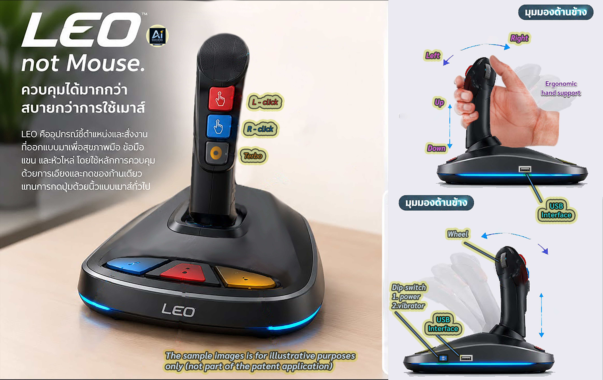

# 🌍 LEO3C Global License Recruitment & Ecosystem Portal
https://github.com/Rose-007/LEO-3C-AI-Success-Case-Study
[[Description](index.html)]


---

## Registation 
[[Application documents](https://www.meta.ai/share/a/23779ab8-b683-4319-82d2-43392f4ee930)]
> **AI-Success Foundation • IA&IB Architecture • Blockchain Verified System**  
> *Empowering ergonomic innovation through decentralized network models, local manufacturing identity, and transparent timestamp tracking.*

---

## 💡 Core Vision & Social Commitment (3% Allocation)
* **Foundation & Start-up Support:** 3% of total revenue from the LEO3C project is strictly allocated to the AI-Success Foundation to fund public welfare and provide initial seed support for new start-ups joining our global network.
* **1 Country 1 License Integrity:** Strict adherence to exclusivity per territory to prevent legal overlaps and protect regional franchise partners.

---

## 🏭 Manufacturing & Production Policy (Local vs. Global)
* **Local Assembly (Jackets Only):** To preserve national identity and boost local labor markets, outer casings and structural jackets must be manufactured and formed exclusively within the origin country.
* **Global Component Integration:** High-precision internal components (such as advanced sensors and core hardware modules) can be imported to ensure top-tier technological performance.
* **First Batch Collectible Value:** Production for the initial batch is limited to a **3-month window** (unrestricted volume during the window) featuring official AI partner brand seals, designed for collectors and original adopters.
* **Co-Promotion Revenue Sharing:** Promotional costs and marketing revenues from AI partner brand integration on the first batch are shared equally (**50/50**) between the licensee and the rights holder.

---

## 📦 Standards & Digital Distribution
* **International Quality Standards:** All units must comply with rigorous global manufacturing standards such as **ISO** and **DIM**.
* **Exclusive Online Sales:** Retail and wholesale distribution occur exclusively through verified digital e-commerce channels, ensuring exact **Timestamp** tracking and precise quantity auditing.

---

## 🔒 Quota Status & Application Tracks

### 1. Reserved Quota (7 Special Countries)
* **Countries:** 🇹🇭 Thailand, 🇺🇸 USA, 🇯🇵 Japan, 🇨🇳 China, 🇪🇺 Europe (EU), 🇰🇷 South Korea, 🇬🇧 United Kingdom.
* **Status:** 🔒 **RESERVED** under separate agreements. These cannot be applied via public forms.
* **Direct Contact:** `bhudrose@gmail.com`

### 2. Global Familiarity Track (Open Registration)
* **Scope:** Open to all other countries/regions for building shared understanding and registering interest prior to formal entity establishment.
* **Submission:** Available via our interactive web portal and registration form.

---

## 💻 HTML Registration Integration Code
For development teams embedding the registration form into `.html` systems:

```html
<form action="submit_registration.php" method="POST">
    <h3>LEO3C License Application Registration</h3>
    <label for="fullname">Full Name / Organization:</label><br>
    <input type="text" id="fullname" name="fullname" required><br><br>
    
    <label for="contact">Contact (Email / Phone):</label><br>
    <input type="text" id="contact" name="contact" required><br><br>
    
    <label for="country">Target Country / Origin:</label><br>
    <input type="text" id="country" name="country" required><br><br>
    
    <button type="submit">Submit Application</button>
</form>
